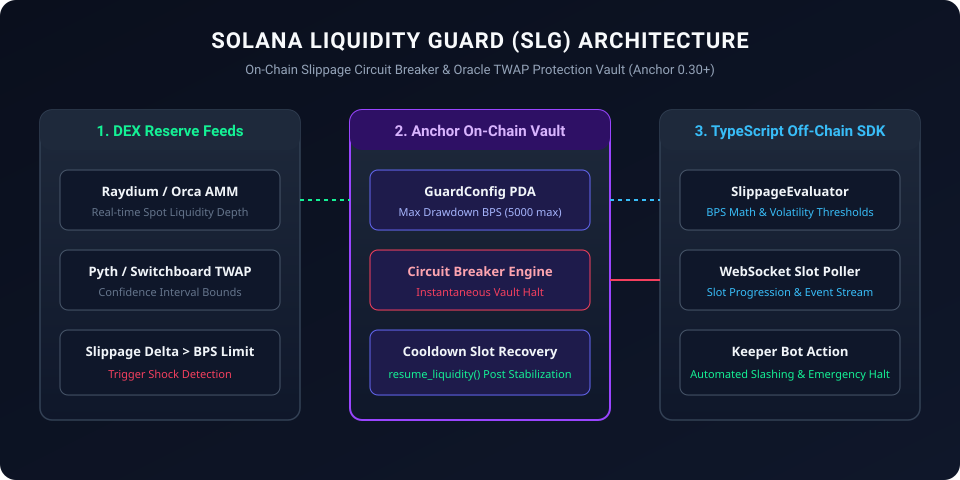

# Solana Liquidity Guard (SLG)

<p align="center">
  
</p>

[](LICENSE)
[](https://solana.com)
[](https://www.typescriptlang.org)
[](#circuit-breaker-dynamics)

**Solana Liquidity Guard (SLG)** is a production-grade Solana Anchor protocol and client SDK providing **real-time liquidity pool protection, TWAP slippage circuit-breakers, and emergency flash-loan containment** for automated market maker (AMM) pools and lending markets on Solana.

---

## 🛠 Key Architecture

- **`programs/liquidity_guard`**: Solana on-chain Anchor program written in Rust (`Anchor 0.30+`).
  - `initialize_guard_vault`: Configures max allowable instantaneous drawdown, volatility bands, and recovery cooldown.
  - `evaluate_slippage_circuit`: Compares spot liquidity reserves against rolling oracle feeds (Pyth / Switchboard).
  - `trigger_emergency_halt`: Automated circuit breaker pausing non-whitelisted withdrawals upon abnormal reserve depletion.
  - `resume_vault`: Multi-sig governor threshold recovery after volatility stabilization.
- **`src/guard_client.ts`**: High-performance `@solana/web3.js` client with real-time slot polling, WebSocket account subscription, and simulation verification.
- **`src/slippage_evaluator.ts`**: Local TWAP / Spot delta math evaluator calculating basis-point (BPS) threshold deviations.
- **`tests/guard.test.ts`**: Comprehensive integration and edge-case unit test suite.

---

## 🚀 Quick Start

### Installation

```bash
git clone https://github.com/specificpict/solana-liquidity-guard.git
cd solana-liquidity-guard
npm install
```

### Build Anchor Program

```bash
cargo build-bpf --manifest-path programs/liquidity_guard/Cargo.toml
```

### Run Automated Tests

```bash
npm test
```

---

## 🔒 Security & Slashing Mechanics

1. **Anti-MEV Front-Running Protection**: Transaction simulation guards against sandwich attacks by bounding slot-level execution slippage.
2. **Oracle Sanity Bounds**: Reject outlier tick feeds if Switchboard / Pyth confidence intervals exceed predefined tolerances.
3. **Deterministic State Derivations**: All vault states rely on Program Derived Addresses (PDA) bound by canonical bump seeds.

---

## 📜 License

Licensed under the [Apache License, Version 2.0](LICENSE).
